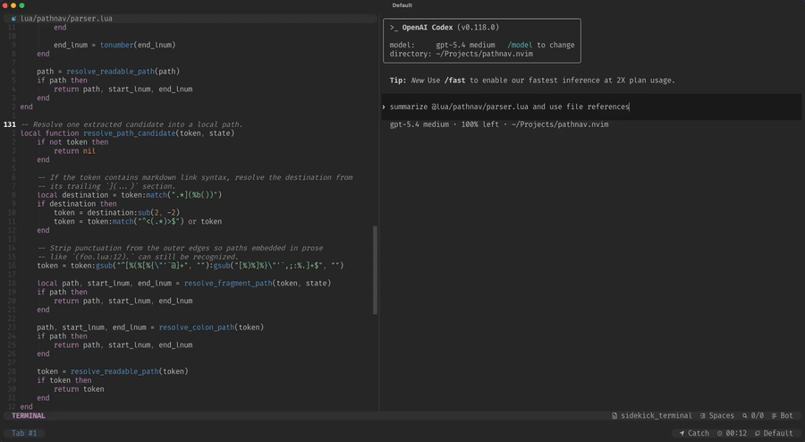

# pathnav.nvim

`pathnav.nvim` is a supercharged `gf` for paths embedded in prose.

It detects paths under the cursor and **opens**, **highlights**, or **jumps**
to the referenced location. It is especially useful for LLM-generated output,
documentation, logs, and markdown, where file references often appear inline
and wrapped in surrounding punctuation.

The plugin understands multiple path formats, such as:

* Absolute / relative paths
* Markdown embedded paths
* `path:line` locations
* `path:line-line` ranges
* GitHub-style `#L` line fragments
* GitHub blob permalinks
* Paths wrapped in surrounding prose or punctuation

It is also **git-aware** and warns you if you try to open a path that does not match your current checked-out commit.

## 🎬 Demo

[](demo.mp4)

## 🚀 API

```lua
---@param opts? pathnav.ConfigOptions
require("pathnav").setup(opts)
```

Initializes and configures the plugin. See [Configuration](#configuration).

```lua
---@param opts? pathnav.OpenOptions
---@return boolean
require("pathnav").open(opts)
```

Opens the path under the cursor. Returns `false` if no readable path could be
resolved; `true` otherwise (including when the user cancels window selection).

| Option | Type | Default | Description |
|---|---|---|---|
| `jump` | `boolean` | `true` | Move the cursor to the referenced location and switch focus to the target window. With `false`, only the current tabpage is searched. |
| `highlight` | `boolean` | `true` | Highlight the referenced line or range. |
| `target_window` | `pathnav.ConfigOptions.TargetWindow` | — | Override target window selection for this call. Same shape as the `target_window` section in `setup()`. |
| `target_tabpage` | `pathnav.ConfigOptions.TargetTabpage` | — | Override the tabpage search for this call. Same shape as the `target_tabpage` section in `setup()`. |

## ⚡️ Requirements

Neovim `0.9.0` or newer

## 📦 Installation with `lazy.nvim`

```lua
{
    "tummetott/pathnav.nvim",
    lazy = true,
    ---@type pathnav.ConfigOptions
    opts = {
        -- Optional config overrides
    },
    keys = {
        {
            "gf",
            function()
                require("pathnav").open()
            end,
            desc = "Jump to file under cursor",
        },
        {
            "<leader>h",
            function()
                require("pathnav").open({
                    jump = false,
                    highlight = true,
                })
            end,
            desc = "Highlight path location",
        },
    },
}
```

## Configuration

```lua
---@type pathnav.ConfigOptions
{
    -- Highlight options for referenced lines.
    highlight = {
        -- Highlight group used for the referenced line or range.
        hlgroup = "PathnavReferenceText",
        -- Events that clear the active reference highlight.
        clear_events = { "CursorMoved" },
    },

    -- Target window selection options.
    target_window = {
        -- Exclude windows from target selection.
        exclude = {
            -- Exclude the current window.
            current = true,
            -- Exclude buffers with these filetypes.
            filetypes = {},
            -- Exclude buffers with these buftypes.
            buftypes = {
                "help",
                "nofile",
                "prompt",
                "quickfix",
                "terminal",
            },
            -- Callback receiving a window id. Returning `true` ignores
            -- that window.
            condition = nil,
        },
        -- Prefer candidate windows that match these conditions.
        prefer = {
            -- Prefer a window that already shows the referenced file.
            matching_file = true,
            -- Prefer the window selected by the previous pathnav jump.
            last_target = false,
        },
        -- Split behavior when a new target window is created.
        split = {
            -- Direction in which the new split opens.
            direction = vim.o.splitright and "right" or "left",
            -- Always open in a new split instead of reusing candidates.
            force = false,
        },
    },

    -- Tabpage search options.
    target_tabpage = {
        -- Callback returning the tabpage handles that may host the target
        -- window, in search order.
        order = function()
            return { vim.api.nvim_get_current_tabpage() }
        end,
        -- Callback receiving a tabpage handle. Returning `true` ignores
        -- that tabpage.
        exclude = nil,
    },

    -- Window picker appearance.
    picker = {
        -- Characters used as picker labels.
        charset = "jklasdfhguiopqwert",
        -- Highlight group used for picker labels.
        hlgroup = "PathnavPickerLabel",
    }
}
```

## 🪟 Window selection

When a path is resolved, the file has to open in some window. You can configure
how that window is chosen. Every window in the current tabpage is a candidate,
except floating windows and those filtered out by `target_window.exclude`.

Selection rules:

1. If there is one candidate, it is used.
2. If there are several, `target_window.prefer` narrows them down.
3. If the choice is still ambiguous, the picker decides.
4. If there is no candidate at all, a new split opens instead.

Picker controls:

* press the displayed label to select a window
* `<Esc>` or invalid input cancels the operation

Setting `target_window.split.force` skips all of this and always opens a new
split.

All of the above happens inside the current tabpage. `target_tabpage` widens
that: pathnav runs the same search in each tabpage you configure, in order,
and stops at the first one that offers a window.

## 🤖 Usage with LLMs

To get navigable file references in LLM output, instruct your agent to use the
following format. Add this to your `AGENTS.md`, system prompt, or equivalent:

```markdown
Always reference files using paths relative to the most appropriate base:
- **Inside cwd**: relative to cwd — `src/server/api.ts`
- **Inside home**: relative to `~` — `~/other-project/src/lib.rs`
- **Anything else**: absolute — `/etc/nginx/nginx.conf`

Allowed formats:
- Whole file: `<path>`
- Single line: `<path>:<line>`
- Line range (inclusive): `<path>:<start>-<end>`
```

`pathnav.nvim` understands all of these formats and will jump directly to the
referenced line or range.

## 🐛 Caveats

`require("pathnav").open()` cannot be used from within an `expr` mapping.

`open()` changes windows, opens buffers, moves the cursor, and adds highlights.
These operations are not allowed while an `expr` mapping is being evaluated.
Deferring the call would fix this, but introduces other edge cases with highlight
clearing.

Use `vim.api.nvim_feedkeys(vim.keycode('<key>'), <mode>, false)` to fall back to
the original key behavior instead.


❤️ Tummetott
